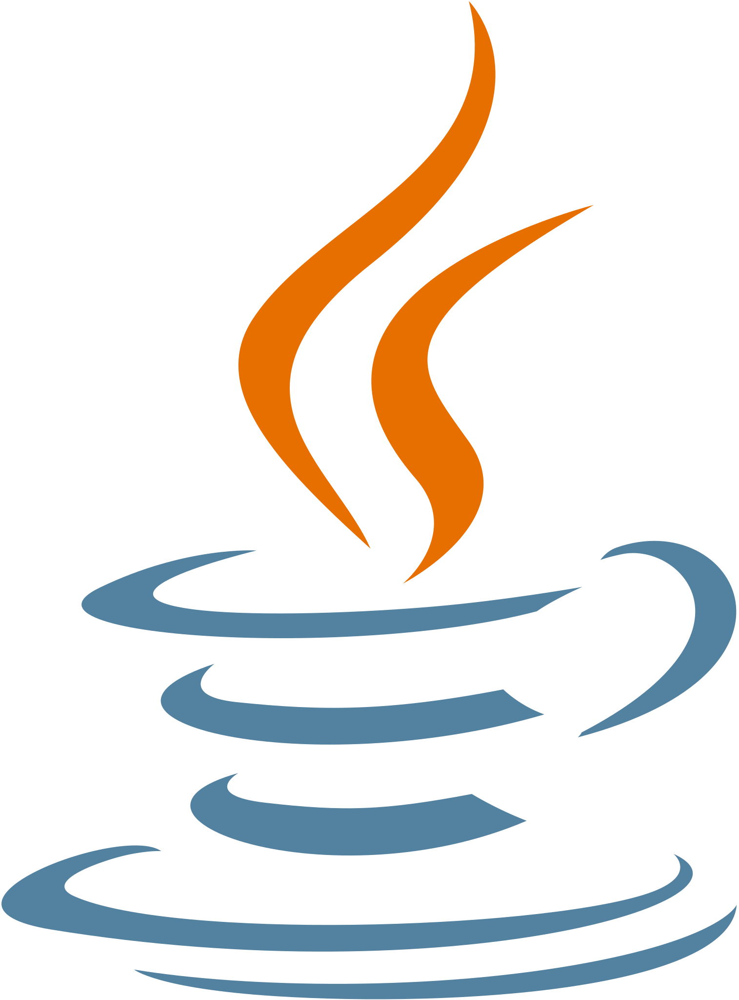
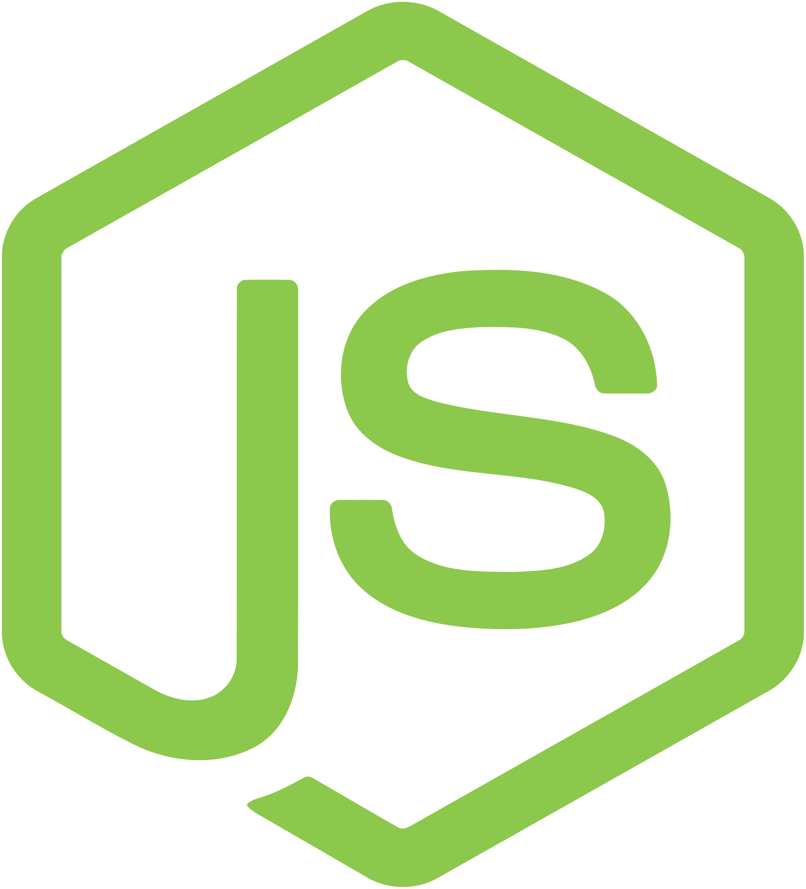
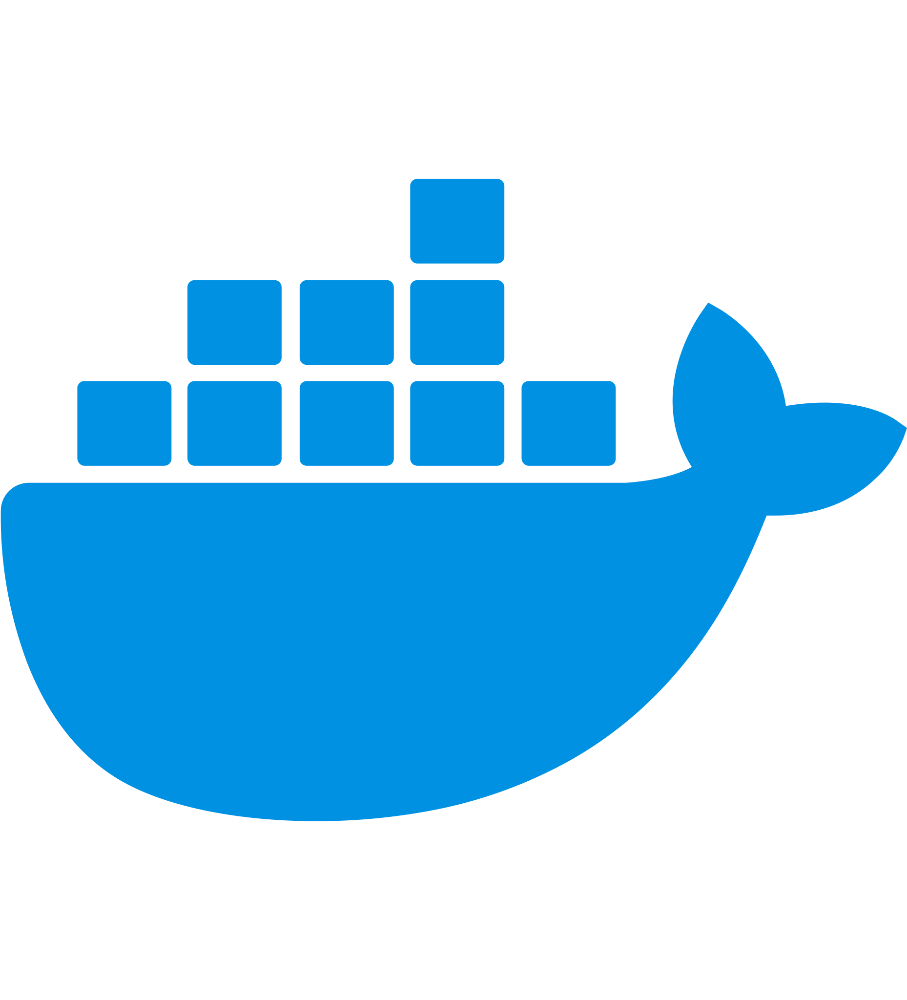

# Software Engineering Notes

Repositório criado para documentar meus estudos em desenvolvimento de software, backend, frontend, banco de dados, infraestrutura e cloud.

O objetivo é organizar conceitos teóricos, fluxos, diagramas e exemplos práticos que demonstrem minha evolução técnica como desenvolvedor Fullstack.

## Tech Stack

 

## Áreas de estudo

- Backend com Java, Spring e Node.js
- APIs REST
- Autenticação e autorização
- Banco de dados SQL
- Frontend com React e Next.js
- Infraestrutura, Docker e Cloud
- Arquitetura de software

## Organização

| Área | Conteúdo |
|---|---|
| Backend | APIs, Spring Boot, autenticação, microsserviços |
| Frontend | React, Next.js, componentização |
| Database | SQL, modelagem, índices |
| Infra & Cloud | Docker, deploy, cloud |
| Diagrams | Fluxos visuais e arquitetura |
| Roadmap | Uma nota por tópico do [portfólio](https://daviribrito.github.io/portfolio/roadmap.html), gerada automaticamente em `roadmap/` |

<!-- roadmap:inicio -->
## Roadmap

Sincronizado com o [roadmap do portfólio](https://daviribrito.github.io/portfolio/roadmap.html): 3 de 17 tópicos dominados. Índice completo em [roadmap/](roadmap/README.md).

- **Fundamentos de backend:** [Paginação por cursor](roadmap/fundamentos/paginacao.md) · [APIs REST com Node.js e PostgreSQL](roadmap/fundamentos/fundamentos-api.md)
- **Confiabilidade:** [Retry com backoff](roadmap/confiabilidade/retry.md) · [Idempotência](roadmap/confiabilidade/idempotencia.md) · [Circuit breaker](roadmap/confiabilidade/circuit-breaker.md) · [Rate limiting](roadmap/confiabilidade/rate-limiting.md)
- **Sistemas distribuídos:** [Transactional outbox](roadmap/distribuidos/outbox.md) · [Sagas e compensação](roadmap/distribuidos/sagas.md) · [Consistência eventual](roadmap/distribuidos/consistencia.md)
- **Testes e qualidade:** [Pirâmide de testes](roadmap/testes/piramide-testes.md) · [Testes de integração com banco](roadmap/testes/testes-integracao.md) · [Fluxo de testes: do TDD ao merge](roadmap/testes/fluxo-testes.md) · [Mocks, stubs e dublês](roadmap/testes/mocks-dubles.md)
- **DevOps e CI/CD:** [Pipeline de CI/CD](roadmap/devops/ci-pipeline.md) · [Containers com Docker](roadmap/devops/docker.md) · [Estratégias de deploy e rollback](roadmap/devops/deploy-estrategias.md) · [Observabilidade: logs, métricas e traces](roadmap/devops/observabilidade.md)
<!-- roadmap:fim -->
